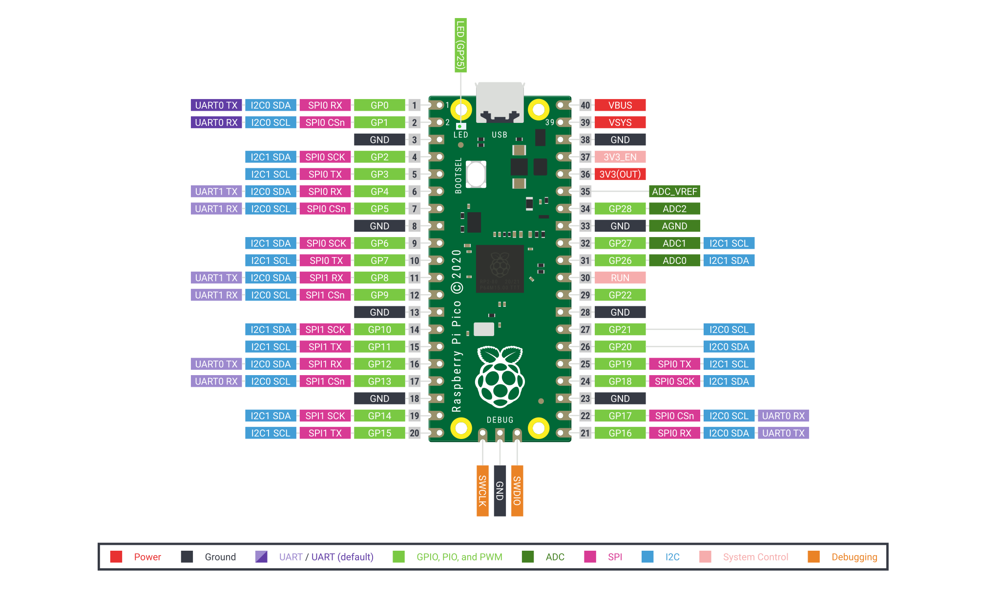
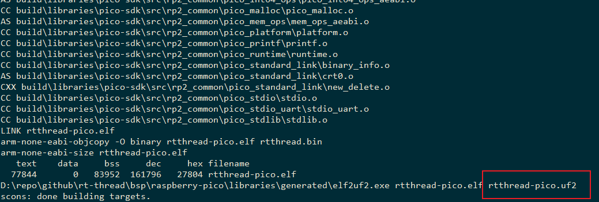

# Raspberry PICO

## Introduction

**Raspberry Pi Pico is a low-cost, high-performance microcontroller board with flexible digital interfaces.**

**Key features include:**

- RP2040 microcontroller chip designed by Raspberry Pi in the United Kingdom
- Dual-core Arm Cortex M0+ processor, flexible clock running up to 133 MHz
- 264KB of SRAM, and 2MB of on-board Flash memory
- Castellated module allows soldering direct to carrier boards
- USB 1.1 with device and host support
- Low-power sleep and dormant modes

- Drag-and-drop programming using mass storage over USB
- 26 × multi-function GPIO pins
- 2 × SPI, 2 × I2C, 2 × UART, 3 × 12-bit ADC, 16 × controllable PWM channels
- Accurate clock and timer on-chip
- Temperature sensor
- Accelerated floating-point libraries on-chip
- 8 × Programmable I/O (PIO) state machines for custom peripheral support




## Supported compiler

Support GCC 6 and above compilers.

## Program firmware

### Step 1: download pico sdk

```bash
pkgs --update
```

### Step 2: build

On Linux or WSL, if the GNU Arm toolchain is installed outside `/usr/bin`,
set `RTT_EXEC_PATH` to the directory containing `arm-none-eabi-gcc` before
running SCons. For example (replace the path with your installation):

```bash
export RTT_EXEC_PATH="/opt/arm-gnu-toolchain/bin"
"$RTT_EXEC_PATH/arm-none-eabi-gcc" --version
```

The BSP passes this directory to the Pico SDK build as well, so you do
not need to add toolchain symlinks under `/usr/bin`.

```bash
scons -c
scons
```

**gcc version >= 6.x.x**

### Step 3: flash

scons generates a UF2 file:



- Copy the rtthread-pico.uf2 file to the "RPI-RP2" disk
- Then led blink.

Or you can use the picotool by:

```bash
picotool load rtthread-pico.uf2
picotool reboot
```

## Running Result

The output information on serial port should be like this:

```bash
 \ | /
- RT -     Thread Operating System
 / | \     4.0.3 build Jan 28 2021
 2006 - 2021 Copyright by rt-thread team
Hello, RT-Thread!
msh >
```

## Peripheral Condition

| Drive | Support | Remark  |
| ----- | ------- | ------- |
| UART  | Support | UART0/1 |
| GPIO  | Support | 0-29    |
| I2C   | Support | -       |
| RTC   | Support | -       |
| SDIO  | -       | -       |
| SPI   | Support | -       |
| TIMER | Support | -       |
| WDT   | Support | -       |
| ADC   | Support | -       |
| FLASH | Support | -       |
| PWM   | Support | -       |
