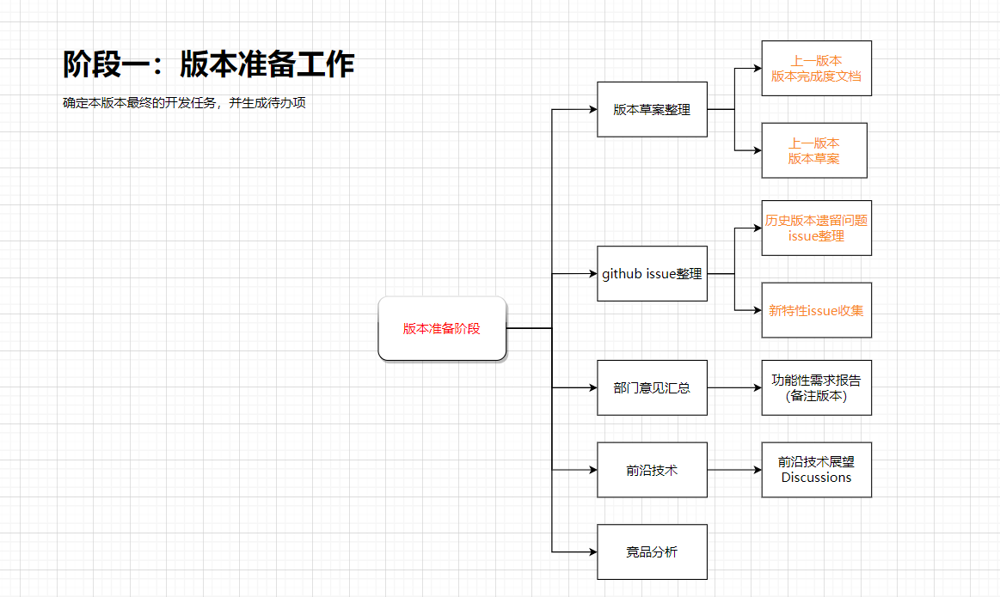
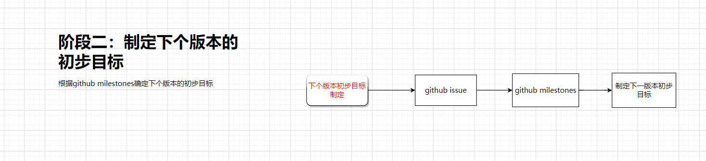
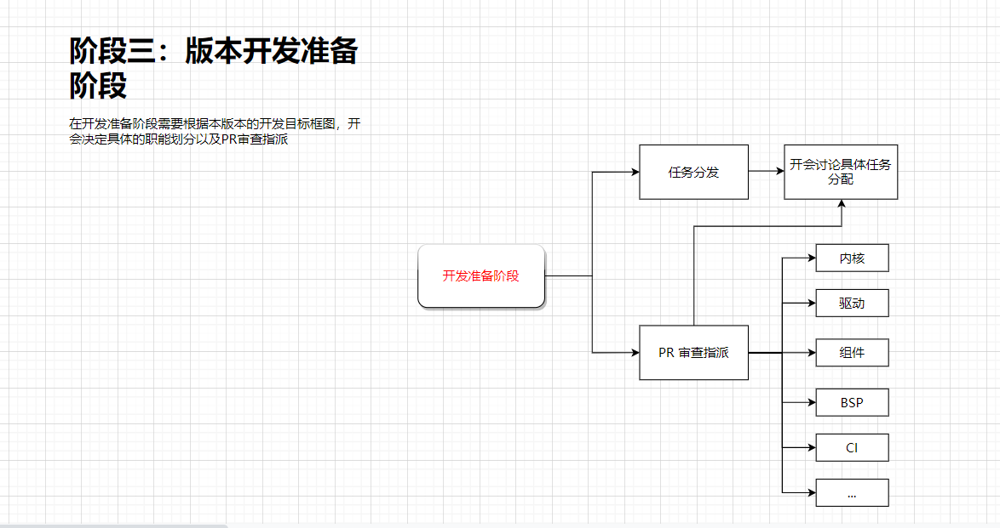
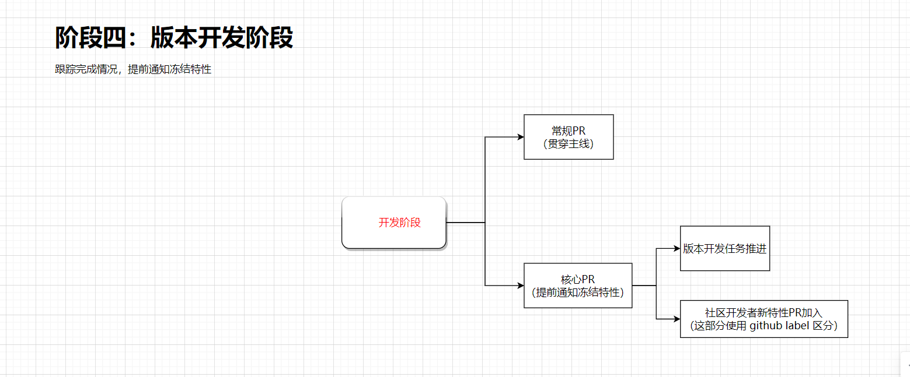
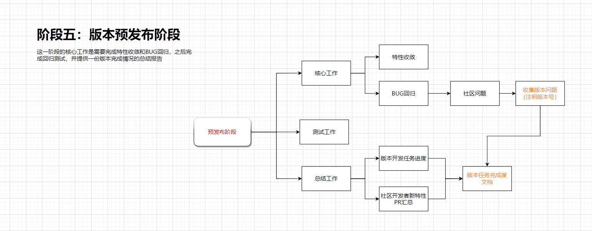
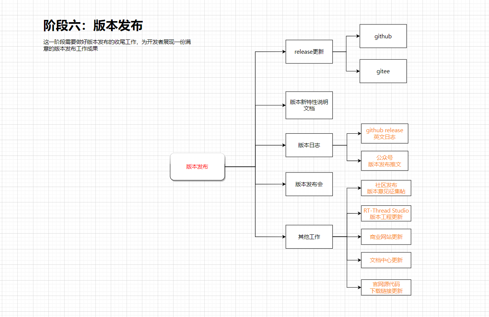
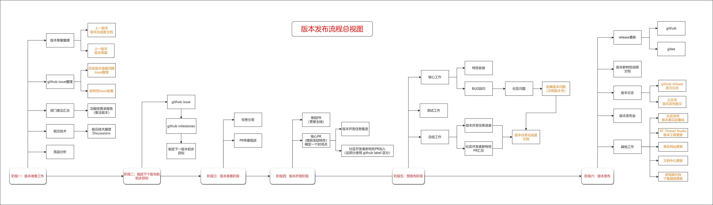

# RT-Thread 版本发布流程

[English](release_process_en.md) | [版本编号制定与实施细则](release_versioning_cn.md)

本文描述 RT-Thread 主线版本从需求准备到正式发布的六个阶段。版本号判定、兼容性要求和发布检查参见[版本编号制定与实施细则](release_versioning_cn.md)。

## 阶段一：版本准备工作

### 1. 首要目标

- 确定本版本最终的开发任务，并生成版本开发任务视图。

### 2. 主要内容

#### 重点内容

- 版本草案整理：整理上一个版本的完成度文档，并结合上一版本的版本开发草案，制定本次版本的初步计划。
- GitHub Issue 整理：整理历史版本遗留问题 Issue，收集版本新特性 Issue，并使用版本 Label 标记。

#### 其他内容

- 其他部门需求汇总：收集其他部门的功能性需求，整理成需求文档。
- 前沿技术：评估市面上的新技术，考虑是否移植到主线，以 Issue 或 Discussions 形式记录。
- 竞品分析：对比同类产品性能差异，分析可引入的特性，以 Issue 或 Discussions 形式记录。

## 阶段二：制定下个版本的初步目标

### 1. 首要目标

- 确定下个版本的初步任务。

### 2. 主要内容

1. 从上一版本发布后开始收集社区需求反馈，整理成 Issue。
2. 根据 Issue 汇总成 Milestone。
3. 制定下一版本的初步目标。

## 阶段三：版本开发准备阶段

### 1. 首要目标

- 根据版本开发任务视图分配开发人员任务。

### 2. 主要内容

- 为本次版本的开发任务分配开发人员。
- 指派审查人员对不同特性的 PR 进行审查。

## 阶段四：版本开发阶段

### 1. 首要目标

- 跟踪完成情况，提前通知冻结特性。

### 2. 主要内容

- 完成版本开发目标，并在版本计划中记录进度。
- 对核心 PR，在发布前半个月通知冻结特性。
- 使用 GitHub Label 标记社区开发者提出的新特性 PR。
- 处理常规 PR，这部分可贯穿版本开发。

## 阶段五：预发布阶段

### 1. 首要目标

- 完成特性收敛和 BUG 回归工作。

### 2. 主要内容

#### 核心工作

- 完成特性收敛工作，推动作者完成新特性 PR 的合并。
- 完成 BUG 回归工作，收集社区反馈的版本问题，包括开发版本及发布版本。

#### 测试工作

- 结合版本测试用例模板，对不同架构、BSP、内核、组件、外设、文件系统等内容进行测试并记录问题。参考[上一版本的测试用例文档](https://docs.qq.com/sheet/DYUFZbEdrek1KWFd4)。

#### 总结工作

- 汇总版本开发任务进度和社区开发者新特性 PR，形成版本任务完成度文档。

## 阶段六：版本发布

### 1. 重点工作

- 在 GitHub 发布版本 Tag 及 Release。
- 在 Gitee 发布版本 Tag 及 Release。
- 编写版本新特性说明文档。
- 编写 GitHub Release 版本英文日志，参考[版本对比](https://github.com/RT-Thread/rt-thread/compare/v5.0.1...v5.0.2)。
- 发布社区公众号版本发布推文。
- 举办版本发布会。

### 2. 其他工作

- 在社区发布版本意见征集帖，邀请开发者参与讨论。
- 更新 RT-Thread Studio 工程文件，发布新版本工程。
- 更新商业网站的芯片支持情况，主要更新新支持的架构，参考[芯片支持页面](https://www.rt-thread.com/products/Chip-39.html)。
- 在文档中心更新新支持功能的文档及链接，参考[文档中心](https://www.rt-thread.org/document/site/#/)。
- 更新官方网站 RT-Thread 源代码网盘下载链接，参考[源代码下载页面](https://www.rt-thread.org/download.html#download-rt-thread-source-code)。

## 版本发布流程总视图

## 参考资料

- [腾讯文档：版本发布流程视图](https://docs.qq.com/flowchart/DVGpndnRmTHdkc3Ji)
