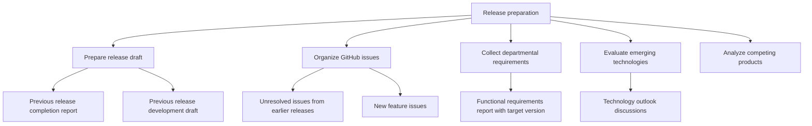
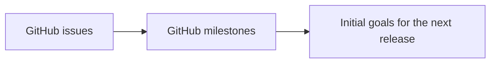
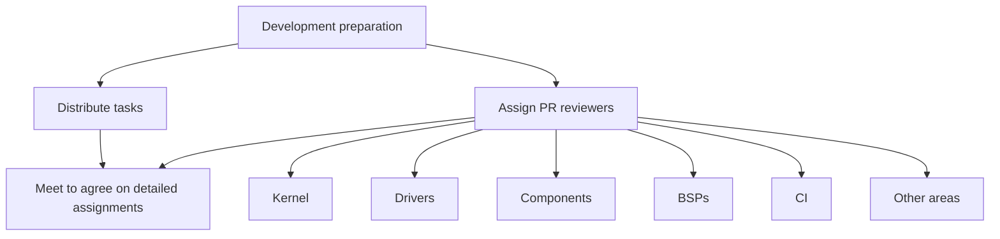
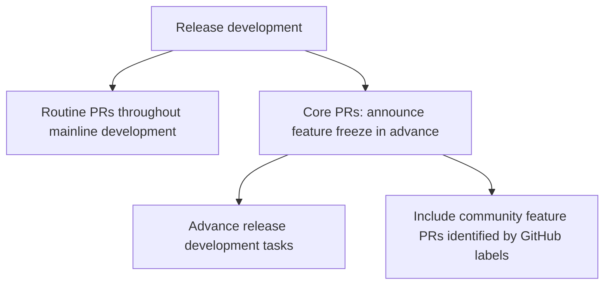
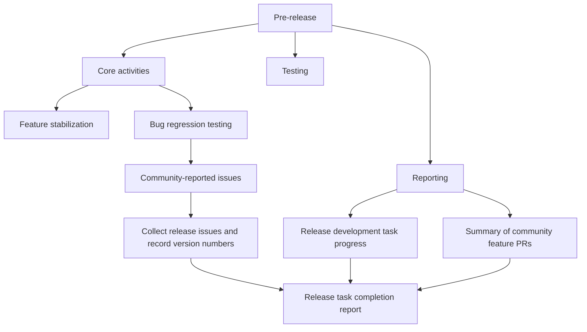
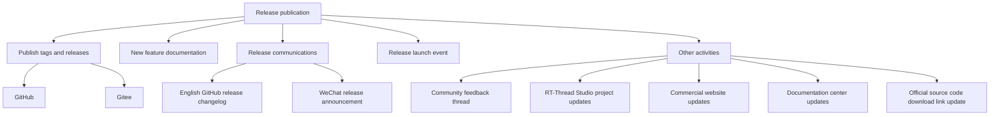
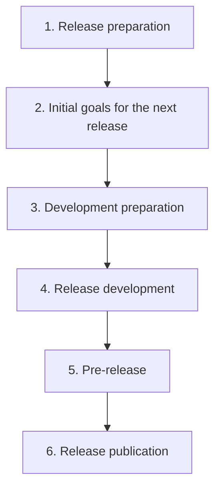

@page page_release_process_en RT-Thread Release Process

# RT-Thread Release Process

[中文](release_process_cn.md) | [Versioning Policy and Implementation Rules](release_versioning_en.md)

This document describes the six stages of an RT-Thread mainline release, from requirements preparation to publication. See the [Versioning Policy and Implementation Rules](release_versioning_en.md) for version classification, compatibility requirements, and the release checklist.

## Stage 1: Release Preparation

### 1. Primary Goal

- Finalize the development tasks for this release and create a view of the release development tasks.

### 2. Main Activities

#### Key Activities

- Prepare the release draft: review the previous release completion report and development draft to create an initial plan for this release.
- Organize GitHub issues: review unresolved issues from earlier releases, collect issues for new features, and mark them with release labels.

#### Other Activities

- Collect requirements from other departments and consolidate functional requirements into a requirements document.
- Evaluate emerging technologies for possible integration into the mainline, recording proposals as issues or discussions.
- Compare the performance of similar products and identify useful features to introduce, recording findings as issues or discussions.

## Stage 2: Define Initial Goals for the Next Release

### 1. Primary Goal

- Define the initial tasks for the next release.

### 2. Main Activities

1. Collect community requirements and feedback as issues, starting after the previous release is published.
2. Group the issues into milestones.
3. Define the initial goals for the next release.

## Stage 3: Development Preparation

### 1. Primary Goal

- Assign development tasks using the release development task view.

### 2. Main Activities

- Assign developers to the development tasks for this release.
- Assign reviewers to PRs for different features.

## Stage 4: Release Development

### 1. Primary Goal

- Track progress and announce the feature freeze in advance.

### 2. Main Activities

- Complete the release development goals and record progress in the release plan.
- For core PRs, announce the feature freeze two weeks before release.
- Mark new feature PRs from community developers with GitHub labels.
- Process routine PRs throughout release development.

## Stage 5: Pre-release

### 1. Primary Goal

- Stabilize features and complete bug regression testing.

### 2. Main Activities

#### Core Activities

- Stabilize the feature set by following up with authors to complete the merging of new feature PRs.
- Complete bug regression testing and collect release issues reported by the community, covering both development and published versions.

#### Testing

- Use the release test case template to test different architectures, BSPs, kernels, components, peripherals, file systems, and other areas, and record issues. See the [previous release test case document](https://docs.qq.com/sheet/DYUFZbEdrek1KWFd4).

#### Reporting

- Combine release development task progress with a summary of new feature PRs from community developers to produce a release task completion report.

## Stage 6: Release Publication

### 1. Key Activities

- Publish the version tag and release on GitHub.
- Publish the version tag and release on Gitee.
- Write documentation describing the new features in the release.
- Write the English changelog for the GitHub release. See the [version comparison example](https://github.com/RT-Thread/rt-thread/compare/v5.0.1...v5.0.2).
- Publish the release announcement on the community's WeChat official account.
- Hold a release launch event.

### 2. Other Activities

- Publish a community thread inviting developers to discuss the release and provide feedback.
- Update RT-Thread Studio project files and publish projects for the new version.
- Update chip support information on the commercial website, focusing on newly supported architectures. See the [chip support page](https://www.rt-thread.com/products/Chip-39.html).
- Update documentation and links for newly supported features in the [documentation center](https://www.rt-thread.org/document/site/#/).
- Update the cloud download link for RT-Thread source code on the official website. See the [source code download page](https://www.rt-thread.org/download.html#download-rt-thread-source-code).

## Release Process Overview

The diagrams above detail the activities within each stage. The overall sequence is:

## References

- [Tencent Docs: Release Process Diagram](https://docs.qq.com/flowchart/DVGpndnRmTHdkc3Ji)
